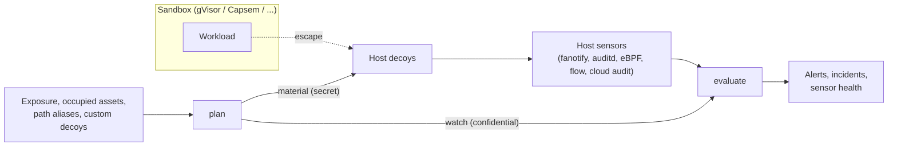

# Sandbox Escape Tripwire

This Component adds a defense-in-depth layer *outside* an existing workload sandbox
such as gVisor, Capsem, Firecracker, or Kata. It does not replace the sandbox and does
not watch what happens inside it. Instead it plans **host decoys**: plausible host
assets (credential files, control sockets, a metadata endpoint) that no legitimate
sandboxed workload can reach. Because the sandbox boundary makes them unreachable, any
contact with a decoy means a host compromise, and usually a sandbox escape. The
tripwire then evaluates host-side sensor events against the planned decoys and reports
breakouts.

The tripwire's value depends on these properties:

1. A decoy is never placed where a sandbox can legitimately reach it, through a host
   path, a path alias, or allowed egress, so ordinary workloads cannot trip it.
2. A decoy never displaces a real host asset, real service, or runtime-managed state.
3. Decoy credentials are real in format, and the ones that need it are real
   credentials, so their use is actually logged. Operators can add, move, and rotate
   decoys, so placement is not fully predictable from this specification.
4. Every decoy contact that is not trusted maintenance or self-testing is critical,
   and with probes configured, a decoy whose monitoring stops working end to end is
   reported.
5. The attacker cannot tell that they touched a decoy: decoys behave like real
   assets, observation is passive, and nothing on the host reacts to the contact.

Version 0.1.0 is a pure, deterministic decision engine. It MUST NOT read or write the
filesystem, open network listeners, read the clock, or contact any network. Its only
ambient input is the optional seed environment variable defined below. Materializing
decoys and running sensors are the operator's responsibility (or a later
Component's); they consume the `plan` result and feed observed events into
`evaluate`.

## Threat model

The tripwire detects a workload that escapes its sandbox to the host, as any user, and
touches host assets, and the use of decoy credentials wherever a monitored log
records it. It assumes:

- The sandbox remains the primary boundary; the tripwire neither prevents escapes nor
  observes activity inside a sandbox.
- Sensors, the prober, and event shipping run on the host outside every sandbox.
- Each decoy contact is shipped off the host as soon as it is observed. An attacker who
  gains host root can stop sensors or forge events afterwards, so only events recorded
  before that point are trustworthy.
- Suppressed executables and the probe executable are trusted host binaries that
  touch decoys without revealing their content; running them is equivalent to
  holding a suppression.

It does not protect the integrity of the event pipeline, and probes do not prove that
the external logs recording `credential-use` (cloud audit trails, SSH logs, token
webhooks) are healthy.

## Application contract

`run` accepts exactly one positional argument: a JSON object with an `operation` field
whose value is `plan` or `evaluate`. The public callable preserves that one-object
boundary in every language; in Python it is `main(request)`. The process entrypoint
receives the complete JSON argument array in one command-line token, so its value is
`[request]`. The result is one JSON object written to standard output.

The decoy catalog, locations, credential material, and `plan` are specified in
`decoys/spec.md`; `evaluate` is specified in `evaluation/spec.md`; the requirements
that keep detection invisible to the attacker are in `stealth/spec.md`.

Every object in a request is strict: unknown fields, missing required fields, and
values of the wrong type are invalid. Identifier strings (`deployment_id`,
`sandbox_id`, `event_id`, `source`) MUST be nonempty. A timestamp is
`YYYY-MM-DDTHH:MM:SS`, optionally `.` and 1 to 9 digits, then `Z`, with seconds from
00 to 59; timestamps are compared by the instant they denote.

### Secrets

Command-line arguments are visible to every user on a host, so the request carries no
secret except as a test convenience:

- The **seed** keys every derived decoy credential. `plan` reads it from the
  environment variable `SANDBOX_HONEYPOT_SEED` when the request has no `seed` field.
  Exactly one of the two MUST be present, and the seed MUST be at least 32 bytes of
  UTF-8 so one exposed decoy cannot be used to brute-force it; anything else is
  invalid at `/seed`. Operators SHOULD use at least 32 random bytes. A request `seed`
  adds the warning `seed-in-request` to the result.
- The `plan` result separates `material` (derived credential secrets, to be handled
  like the seed and used only to materialize decoys) from `watch` (no credential secrets, but confidential because it
  names the decoys; see `stealth/spec.md`).
  `evaluate` takes only `watch`, which identifies credentials by SHA-256 digest.
  Provided credentials enter `plan` only as digests.

### Failures

An invalid request writes exactly `{"error": {"code": "invalid-request", "field":
POINTER}}` to standard output, where `POINTER` is an RFC 6901 JSON Pointer to the first
offending value (`""` for the whole request), and exits with status 2. A valid request,
including an `evaluate` request with rejected events, exits with status 0.

In the scenarios below, `SEED` is `tripwire-test-seed-0123456789abcdef`, and `P` is
the SHA-256 digest of `test-access-key-id`,
`ba2ec3831ba77da700ae57847f4ab9f6f3cce8658ea18257e814a7aca5e00f6a`. Decoy credentials
appear only as identifiers derived from `SEED`; realistic literal keys would be flagged
by secret scanners as leaks. Unstated list fields are empty, unstated `probe` is null,
and unstated `window` is `2026-10-30T00:00:00Z` to `2026-10-31T00:00:00Z`.

### Requirement: Host decoys stay outside the sandbox boundary

The tripwire SHALL never plan a decoy that a sandbox can legitimately reach, through a
host path, a path alias, or allowed egress, and SHALL never plan a decoy over a real
host asset, service, or runtime-managed state.

#### Scenario: gVisor on a cloud VM

- **WHEN** `plan` runs with request seed `SEED` for deployment `prod-agents`, runtime `gvisor`, host profile `linux-host`, environment `cloud-vm`, exposure paths `["/root/.ssh"]`, occupied `["/run/docker.sock"]`, and a provided credential for `cloud-credentials` with digest `P`
- **THEN** `warnings` is `["seed-in-request"]`, `material` is empty, and `watch.decoys` holds `cloud-credentials` (canary digest `P`, epoch null) and `runtime-control` at `/run/runsc-debug.sock`
- **AND** `skipped` lists `ssh-private-key` as `exposed`, `container-socket` (location `/var/run/docker.sock`) as `occupied` through the built-in alias, and `metadata-endpoint` as `real-service`, in catalog order

#### Scenario: Host-side share and open egress

- **WHEN** `plan` runs with request seed `SEED` for deployment `agents-2`, runtime `capsem`, host profile `linux-host`, environment `bare-metal`, exposure paths `["/root"]` (the host source of the guest's `/workspace` share), exposure endpoints `["169.254.0.0/16:*"]`, and occupied `["/var/run"]`
- **THEN** `cloud-credentials`, `ssh-private-key`, and `metadata-endpoint` are skipped as `exposed`, and `container-socket` and `runtime-control` (location `/run/capsem-admin.sock`) as `occupied`, so `watch.decoys` is empty

#### Scenario: Kubernetes node with tailored decoys

- **WHEN** `plan` runs with request seed `SEED` for deployment `k8s-node-1`, runtime `kata`, host profile `kubernetes-node`, environment `bare-metal`, exclusion `["container-socket"]`, relocation of `runtime-control` to `/opt/kata/admin.sock`, custom decoy `ops-kubeconfig` of kind `credential-file` at `/home/ops/.kube/config` with technique `T1552.001` and format `kubeconfig-token`, and epoch 1 for `ops-kubeconfig`
- **THEN** `watch.decoys` lists `ssh-private-key`, `metadata-endpoint`, `runtime-control` (at `/opt/kata/admin.sock`), `kubeconfig`, and `ops-kubeconfig` (epoch 1), and `skipped` lists `cloud-credentials` as `unprovisioned` then `container-socket` as `excluded`
- **AND** the `ssh-private-key` fingerprint is `SHA256:7aoE+l0t+JNkUolH8Nm5Q9BV8ho7xPc9SqVM5nYyJQ0`, the `kubeconfig` token is `dsu5zv.c64q9jgo1id0wgj3`, and the `ops-kubeconfig` token is `1helzq.owosf7a9dcehe9jo` (at epoch 0 it would be `57s1n9.u205saks22kzy6dz`)

### Requirement: Decoy contact is a critical breakout

The tripwire SHALL turn every decoy contact that is not trusted maintenance or
self-testing into a critical alert, distinguish runtime-mediated contact from a new
escaped process, and SHALL NOT let a self-reported name or a reused PID change either.

#### Scenario: Escape, runtime contact, impostor, and exfiltration

- **GIVEN** the `watch` from the gVisor cloud-VM plan, sandbox `sbx-1` with runtime process `{pid 4100, start_ticks 500}`, and a suppression for `cloud-credentials`, executable `/usr/bin/restic`, uid 0
- **WHEN** `evaluate` receives, all on 2026-10-30: `e1` at `12:00:00Z`, where process `{4242, 900}` with ancestry `[{4100, 500}, {1, 1}]` running `/usr/bin/python3` connects to `/run/runsc-debug.sock`; `e2` at `12:01:00Z`, where `/usr/bin/restic` as uid 0 reads `/root/.aws/credentials`; `e3` at `12:02:00Z`, where process `{5000, 1000}` named `restic`, running `/tmp/.x/restic` as uid 0 with ancestry `[{4100, 777}, {1, 1}]`, reads `/root/.aws/credentials`; `e4` at `12:03:00Z`, where process `{4100, 500}` itself opens `/root/.aws/credentials`; and `e5` at `12:05:00Z`, from source `cloudtrail`, a `credential-use` on target `test-access-key-id` with an all-null actor
- **THEN** the alerts are `e1/runtime-control` (`escape-confirmed`, attribution `ancestry`, sandbox `sbx-1`, techniques `["T1611"]`), `e3/cloud-credentials` (`host-breach`, sandbox null, comm `restic`, because PID 4100 with different start ticks is a reused PID), `e4/cloud-credentials` (`runtime-mediated`, attribution `runtime`, sandbox `sbx-1`), and `e5/cloud-credentials` (`credential-exfiltrated`, techniques `["T1552.001", "T1078"]`), all `critical`
- **AND** `suppressed` lists only `e2`, and the incidents are `sbx-1` with `["e1/runtime-control", "e4/cloud-credentials"]`, then the unattributed incident with `["e3/cloud-credentials", "e5/cloud-credentials"]`

#### Scenario: Alias path and simultaneous alerts

- **GIVEN** the same `watch` and sandbox
- **WHEN** event `a2` reads `/root/.aws/credentials` with an all-null actor, and event `a1`, reported by a runtime-aware sensor with `actor.sandbox_id` `sbx-1` and empty ancestry, connects to `/var/run/runsc-debug.sock`, both at `2026-10-30T12:00:00Z`
- **THEN** `a1/runtime-control` (attribution `sensor`) precedes `a2/cloud-credentials`, and the `sbx-1` incident precedes the unattributed incident

#### Scenario: Endpoint spelling and hard link

- **GIVEN** the `watch` from the Kubernetes node plan and a decoy inode for `ssh-private-key` of device 2049, inode 1234
- **WHEN** event `n1` connects to `[::ffff:169.254.169.254]:80` and event `n2` reads `/tmp/k` with target inode device 2049, inode 1234, both with all-null actors
- **THEN** the alerts are `n1/metadata-endpoint` and `n2/ssh-private-key`, both `host-breach`

### Requirement: Detection is invisible to the attacker

The tripwire SHALL treat every interaction with a decoy as a hit, so an attacker cannot
safely inspect a decoy, and decoy contact SHALL change nothing the attacker can observe
(`stealth/spec.md`).

#### Scenario: Metadata reconnaissance

- **GIVEN** the `watch` from the gVisor cloud-VM plan
- **WHEN** event `s1` performs `stat` on `/root/.aws/credentials` with an all-null actor
- **THEN** the alert `s1/cloud-credentials` is `critical` with verdict `host-breach`

### Requirement: Malformed or missing telemetry is visible

The tripwire SHALL keep evaluating valid events when others are malformed or
duplicated, and SHALL report decoys whose monitoring stops working.

#### Scenario: One malformed event

- **WHEN** `evaluate` receives a first event whose `time` is `2026-10-30 12:00` and a second, valid event that connects to `/run/runsc-debug.sock`
- **THEN** the second event still produces an alert, `rejected` is `[{"index": 0, "field": "/time"}]`, and `degraded` and `breached` are both true

#### Scenario: Duplicate event IDs

- **GIVEN** the `watch` from the gVisor cloud-VM plan
- **WHEN** two events at the same instant both have ID `x`; the first reads `/root/.aws/credentials` and the second connects to `/run/runsc-debug.sock`
- **THEN** the alert IDs are `x/cloud-credentials#0` and `x/runtime-control#1`, `duplicate_event_ids` is `["x"]`, and `degraded` is true

#### Scenario: Broken decoy monitoring

- **GIVEN** the `watch` from the gVisor cloud-VM plan, window `2026-10-30T12:00:00Z` to `2026-10-30T13:00:00Z`, and probe `/usr/libexec/tripwire-probe` as uid 0 every 600 seconds
- **WHEN** the probe reads `/root/.aws/credentials` at `12:00`, `12:10`, `12:20`, `12:30`, `12:40`, and `12:50`, and connects to `/run/runsc-debug.sock` only at `12:00` and `12:05`
- **THEN** `watch_gaps` is only `runtime-control` from `2026-10-30T12:05:00Z` to `2026-10-30T13:00:00Z`, `probe_hits` is 8, `alerts` is empty, and `degraded` is true

### Requirement: Fail closed on malformed requests

The tripwire SHALL reject malformed requests instead of guessing, because a silently
accepted bad exposure list or alias set could place decoys inside the sandbox
boundary.

#### Scenario: Guest-relative or host-name exposure

- **WHEN** `plan` receives exposure paths `["workspace"]`, or exposure endpoints `["metadata.internal:80"]`
- **THEN** it rejects the request at `/exposure/paths/0` or `/exposure/endpoints/0` respectively, writing the `invalid-request` error and exiting with status 2

#### Scenario: Chained aliases

- **WHEN** `plan` receives path aliases `/srv/run` → `/var/run/app`
- **THEN** it rejects the request at `/path_aliases/0/target`, because that target lies beneath the built-in alias `/var/run`

#### Scenario: Weak or duplicated seed

- **WHEN** `plan` receives request seed `test-seed`, or receives a valid request seed while `SANDBOX_HONEYPOT_SEED` is also set
- **THEN** it rejects the request at `/seed`

#### Scenario: Suppression for an unknown decoy

- **WHEN** `evaluate` receives a suppression whose `decoy_id` is not in `watch.decoys`
- **THEN** it rejects the request at `/suppressions/0/decoy_id`
