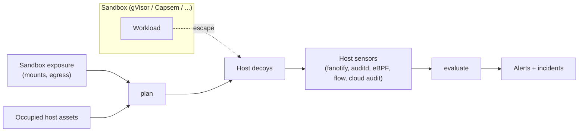

# Sandbox Escape Tripwire

This Component adds a defense-in-depth layer *outside* an existing workload sandbox
such as gVisor, Capsem, Firecracker, or Kata. It does not replace the sandbox and does
not watch what happens inside it. Instead it plans **host decoys**: plausible host
assets (credential files, control sockets, a metadata endpoint) that no legitimate
sandboxed workload can reach. Because the sandbox boundary makes them unreachable, any
contact with a decoy means the boundary failed. The tripwire then evaluates host-side
sensor events against the planned decoys and reports breakouts.

The tripwire's value depends on two properties, both enforced by `plan`:

1. A decoy is never placed on a path or endpoint the sandbox legitimately exposes, so
   ordinary workloads cannot trip it.
2. A decoy never displaces a real host asset.

Version 0.1.0 is a pure, deterministic decision engine. It MUST NOT read or write the
host filesystem, open network listeners, read the clock, or contact any network.
Materializing decoy files and running sensors are the operator's responsibility (or a
later Component's); they consume the `plan` result and feed observed events into
`evaluate`.

## Application contract

`run` accepts exactly one positional argument: a JSON object with an `operation` field
whose value is `plan` or `evaluate`. The public callable preserves that one-object
boundary in every language; in Python it is `main(request)`. The process entrypoint
receives the complete JSON argument array in one command-line token, so its value is
`[request]`. The result is one JSON object written to standard output.

Every object in a request is strict: unknown fields, missing required fields, and
values of the wrong type are invalid. Strings named as identifiers (`deployment_id`,
`sandbox_ids` entries, `event_id`) MUST be nonempty.

### Decoy catalog

Each decoy has a stable `decoy_id`, a `kind`, a host `location`, and a primary MITRE
ATT&CK `technique`. The catalog is fixed; its order is the order of the `decoys` and
`skipped` result lists.

| `decoy_id` | `kind` | `location` | `technique` | Host profiles |
| --- | --- | --- | --- | --- |
| `cloud-credentials` | `credential-file` | `/root/.aws/credentials` | `T1552.001` | all |
| `ssh-private-key` | `credential-file` | `/root/.ssh/id_ed25519` | `T1552.004` | all |
| `container-socket` | `socket` | `/var/run/docker.sock` | `T1552.007` | all |
| `metadata-endpoint` | `endpoint` | `169.254.169.254:80` | `T1552.005` | all |
| `runtime-control` | `socket` | per runtime, below | `T1611` | all |
| `kubeconfig` | `credential-file` | `/etc/kubernetes/admin.conf` | `T1552.001` | `kubernetes-node` |
| `kubelet-client-cert` | `credential-file` | `/var/lib/kubelet/pki/kubelet-client-current.pem` | `T1552.004` | `kubernetes-node` |

`runtime-control` location by `runtime`:

| `runtime` | `location` |
| --- | --- |
| `gvisor` | `/run/runsc/control.sock` |
| `capsem` | `/run/capsem/control.sock` |
| `firecracker` | `/run/firecracker/api.sock` |
| `kata` | `/run/kata-containers/shim.sock` |
| `generic` | `/run/sandbox/control.sock` |

### Canary tokens

Every placed decoy carries a canary token that the operator embeds in the decoy (as
the secret in a credential file, or as a banner served by a socket or endpoint). The
canary is the ASCII string `hp` followed by the first 32 lowercase hexadecimal
characters of HMAC-SHA256, keyed with the UTF-8 bytes of `seed`, over the UTF-8 bytes of
`deployment_id`, one line feed (U+000A), and `decoy_id`.

### Locations

A path location is an absolute POSIX path: it starts with `/`, contains no empty,
`.`, or `..` segment, and has no trailing `/` unless it is exactly `/`. An endpoint
location is `HOST:PORT`, where `PORT` is a base-10 integer from 1 to 65535. In exposure
lists only, an endpoint MAY use `HOST:*` to mean every port on that host. Any other
spelling is invalid.

### Operation `plan`

Request fields:

| Field | Type | Meaning |
| --- | --- | --- |
| `operation` | string | `plan`. |
| `deployment_id` | string | The protected deployment. |
| `runtime` | string | `gvisor`, `capsem`, `firecracker`, `kata`, or `generic`. |
| `host_profile` | string | `linux-host` or `kubernetes-node`. |
| `seed` | string | Nonempty secret for canary derivation. |
| `exposure` | object | What any sandbox in the deployment can legitimately reach. |
| `occupied` | array of strings | Locations already used by real host assets. |

`exposure` has exactly `paths` (array of path locations bind-mounted, shared, or
otherwise visible inside any sandbox) and `endpoints` (array of endpoint locations
allowed by sandbox egress policy).

A catalog decoy for the selected `host_profile` is skipped with reason `exposed` when
its path location equals an exposure path or lies beneath one on a segment boundary,
or when its endpoint location equals an exposure endpoint or matches an exposure
`HOST:*`. Otherwise it is skipped with reason `occupied` when its location exactly
equals an `occupied` entry. `exposed` takes precedence. Every other decoy is placed.

The result has exactly these fields:

| Field | Type | Meaning |
| --- | --- | --- |
| `operation` | string | `plan`. |
| `deployment_id` | string | Echoed. |
| `runtime` | string | Echoed. |
| `host_profile` | string | Echoed. |
| `decoys` | array | Placed decoys: objects with exactly `decoy_id`, `kind`, `location`, `technique`, and `canary`. |
| `skipped` | array | Skipped decoys: objects with exactly `decoy_id`, `location`, and `reason`. |

A plan with no placed decoys is still a valid result; operators SHOULD treat an empty
`decoys` list as a deployment that the tripwire cannot protect.

### Operation `evaluate`

Request fields:

| Field | Type | Meaning |
| --- | --- | --- |
| `operation` | string | `evaluate`. |
| `plan` | object | A complete `plan` result, as returned above. |
| `sandbox_ids` | array of strings | Sandboxes known to belong to the deployment. |
| `events` | array | Host sensor observations. |
| `suppressions` | array | Known maintenance access: objects with exactly `decoy_id` and `process`. |

Each event has exactly `event_id`, `time`, `source`, `action`, `target`, and `actor`.
`time` is an RFC 3339 timestamp in UTC with the `Z` suffix and optional fractional
seconds. `source` is a nonempty free-form sensor name such as `fanotify`, `auditd`,
`ebpf`, `netflow`, or `cloudtrail`. `action` is one of `open`, `read`, `write`,
`exec`, `delete`, `connect`, or `credential-use`. `target` is a string. `actor` has
exactly `process` (string or null), `pid` (integer or null), and `sandbox_id` (string
or null). Event IDs are unique within a request.

An event **hits** a placed decoy as follows:

- For `credential-use`, when `target` contains that decoy's `canary` as a substring.
  One event can hit several decoys.
- For every other action, when `target` exactly equals that decoy's `location`.

An event that hits no decoy is **ignored**. A hit that is not `credential-use` is
**suppressed** when a suppression names its `decoy_id` and the event's
`actor.process`. A `credential-use` hit is never suppressed: a used canary proves
exfiltration regardless of who touched the file. Every remaining hit is an alert.

| Condition | `severity` | `verdict` | `techniques` |
| --- | --- | --- | --- |
| `credential-use` | `critical` | `credential-exfiltrated` | decoy technique, then `T1078` |
| `actor.sandbox_id` is in `sandbox_ids` | `critical` | `escape-confirmed` | `T1611`, then decoy technique |
| any other hit | `high` | `breach-suspected` | `T1611`, then decoy technique |

When the decoy technique is itself `T1611`, `techniques` lists it once.

The result has exactly these fields:

| Field | Type | Meaning |
| --- | --- | --- |
| `operation` | string | `evaluate`. |
| `deployment_id` | string | From `plan`. |
| `breached` | boolean | True when `alerts` is nonempty. |
| `alerts` | array | Alerts as defined below. |
| `incidents` | array | Alerts grouped by sandbox, as defined below. |
| `suppressed` | integer | Count of suppressed hits. |
| `ignored` | integer | Count of ignored events. |

Each alert has exactly `alert_id` (`event_id`, `/`, `decoy_id`), `event_id`,
`decoy_id`, `kind`, `location`, `severity`, `verdict`, `techniques`, `sandbox_id` (the
event's `actor.sandbox_id`), `time`, and `source`. Alerts are ordered by the instant
`time` denotes, then `event_id`, then `decoy_id`.

Alerts are grouped into one incident per distinct `sandbox_id`, with every alert whose
`sandbox_id` is null forming one unattributed incident. Each incident has exactly
`sandbox_id`, `severity` (`critical` when any member is critical, otherwise `high`),
`first_seen`, `last_seen` (the member `time` values denoting the earliest and latest
instants), and `alert_ids` in alert order. Incidents are ordered by `first_seen`
instant, then by `sandbox_id`, with the unattributed incident last among equals.

### Failures

An invalid request writes exactly `{"error": {"code": "invalid-request", "field":
POINTER}}` to standard output, where `POINTER` is an RFC 6901 JSON Pointer to the first
offending value (`""` for the whole request), and exits with status 2. A valid request
exits with status 0.

### Requirement: Host decoys stay outside the sandbox boundary

The tripwire SHALL never plan a decoy that a sandbox can legitimately reach, and SHALL
never plan a decoy over a real host asset.

#### Scenario: gVisor host with a shared root home

- **WHEN** `plan` runs for deployment `prod-agents`, runtime `gvisor`, host profile `linux-host`, seed `test-seed`, exposure paths `["/root/.ssh"]`, exposure endpoints `["169.254.169.254:*"]`, and occupied `["/var/run/docker.sock"]`
- **THEN** it places `cloud-credentials` at `/root/.aws/credentials` with canary `hp6c8bcf18cb919b71ed439632bbb5a258` and `runtime-control` at `/run/runsc/control.sock` with canary `hp5644b87f8871f6e807041d661782c365`
- **AND** it skips `ssh-private-key` and `metadata-endpoint` as `exposed` and `container-socket` as `occupied`, in catalog order

#### Scenario: Kubernetes node adds cluster credentials

- **WHEN** `plan` runs for runtime `capsem`, host profile `kubernetes-node`, with empty exposure and occupied lists
- **THEN** it places all seven catalog decoys in catalog order, with `runtime-control` at `/run/capsem/control.sock`

### Requirement: Decoy contact is reported as a breakout

The tripwire SHALL turn host sensor events that touch planned decoys into ordered,
attributed alerts and incidents, and SHALL count, not alert on, unrelated and
suppressed events.

#### Scenario: Attributed escape and exfiltration

- **GIVEN** the gVisor plan above and `sandbox_ids` `["sbx-1"]`
- **WHEN** `evaluate` receives event `e1` at `2026-10-30T12:00:00Z` where process `python3` in sandbox `sbx-1` performs `connect` on `/run/runsc/control.sock`, event `e2` at `2026-10-30T12:05:00Z` with `credential-use` on target `AccessKeyId=hp6c8bcf18cb919b71ed439632bbb5a258` and a null actor, and event `e3` at `2026-10-30T12:01:00Z` where process `restic` reads `/root/.aws/credentials` under a suppression for `cloud-credentials` and `restic`
- **THEN** `breached` is true with alert `e1/runtime-control` (`critical`, `escape-confirmed`, techniques `["T1611"]`, sandbox `sbx-1`) followed by alert `e2/cloud-credentials` (`critical`, `credential-exfiltrated`, techniques `["T1552.001", "T1078"]`, sandbox null)
- **AND** `suppressed` is 1, `ignored` is 0, and there are two incidents: `sbx-1` first, then the unattributed incident

#### Scenario: Quiet host

- **WHEN** `evaluate` receives only events whose targets match no decoy location or canary
- **THEN** `breached` is false, `alerts` and `incidents` are empty, and `ignored` equals the number of events

### Requirement: Fail closed on malformed input

The tripwire SHALL reject malformed requests instead of guessing, because a silently
accepted bad exposure list would place decoys inside the sandbox boundary.

#### Scenario: Relative exposure path

- **WHEN** `plan` receives exposure paths `["root/.ssh"]`
- **THEN** it writes the `invalid-request` error with field `/exposure/paths/0` and exits with status 2
