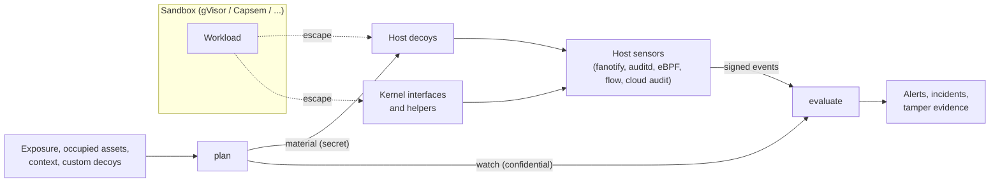

# Sandbox Escape Tripwire

This Component adds a defense-in-depth layer *outside* an existing workload sandbox
such as gVisor, Capsem, Firecracker, Cloud Hypervisor, or Kata. It does not replace
the sandbox and does not watch what happens inside it. Instead it plans **host
decoys**: plausible host assets (credential files, control sockets, host service
endpoints) that no legitimate sandboxed workload can reach, plus **tripwires** on the
kernel interfaces and helpers that escape techniques hijack. Any contact means a host
compromise, and usually a sandbox escape. The tripwire then evaluates host-side sensor
events against the plan and reports breakouts.

The tripwire's value depends on these properties:

1. A decoy is never placed where a sandbox can legitimately reach it, through a host
   path, a path alias, or allowed egress, so ordinary workloads cannot trip it.
2. A decoy never displaces a real host asset, real service, or runtime-managed state,
   and never sits where a real account's tools would use it.
3. Decoy credentials are real in format, and the ones that need it are real
   credentials, so their use is actually logged, before and after rotation.
4. Every contact with a planted decoy, hijack-shaped kernel-interface write, and
   unexpected kernel helper that is not trusted maintenance or self-testing is critical.
5. The attacker cannot tell that they touched a decoy: decoys behave like real
   assets, observation is passive, and nothing on the host reacts to the contact.
6. Escapes that never touch bait are still seen: writes to kernel interfaces that
   hijack host-root helpers are tripwires, and processes those helpers launch are
   attributed as escapes.
7. Escapes that need no exploit are still seen: code an agent harness runs outside
   its sandbox is attributed to that harness.
8. Broken or tampered monitoring is visible: events are authenticated per sensor, and
   failed probes, silent or restarted sensors, dropped or replayed records, and
   uncorroborated contacts are reported.

Version 0.1.0 is a pure, deterministic decision engine. It MUST NOT read or write the
filesystem, open network listeners, read the clock, or contact any network. Its only
ambient inputs are the optional environment variables `SANDBOX_HONEYPOT_SEED` and
`SANDBOX_HONEYPOT_SENSOR_KEYS`. Materializing decoys and running sensors are the
operator's responsibility (or a later Component's); they consume the `plan` result and
feed observed events into `evaluate`.

## Threat model

The tripwire detects a workload that escapes its sandbox to the host, as any user, and
touches host assets or hijacks a kernel helper; an agent harness persuaded to run code
outside its sandbox; a sandbox reaching for host SSH; and the use of decoy credentials
wherever a monitored log records it. Attackers are assumed to be capable AI agents that
know published escape techniques, can read this specification, and actively look for
decoys. It assumes:

- The sandbox remains the primary boundary; the tripwire neither prevents escapes nor
  observes activity inside a sandbox.
- Sensors, the prober, and event shipping run on the host outside every sandbox, and
  `plan` and `evaluate` run on a separate analysis system.
- Events leave the host within seconds of observation. An attacker who gains host root
  or kernel write access can stop sensors, steal their keys, or forge events
  afterwards, so only events recorded before that point are trustworthy; probes,
  silence, sequences, and corroboration make later tampering visible, not impossible.
  A source whose events the collector signs is trusted to the collector's level.
- Suppressed executables and the probe are trusted like the host's own maintenance:
  an attacker who can run them with chosen arguments can read decoys without an
  alert. Keep suppressions few and bound to an executable digest, user, and, for
  kernel interfaces, the expected written value, and never suppress a shell or
  general-purpose interpreter, which would trust every script it runs.

It never runs code on the attacker's side, even to attribute them: identification is
passive and uses only what host sensors recorded.

## Application contract

`run` accepts exactly one positional argument: a JSON object with an `operation` field
whose value is `plan` or `evaluate`. The public callable preserves that one-object
boundary in every language; in Python it is `main(request)`. The process entrypoint
receives the complete JSON argument array in one command-line token, so a request MUST
fit in one argument (128 KiB on Linux): operators split a long period into consecutive
`evaluate` batches joined by `carry` (`telemetry/spec.md`). Event limits keep each
event under 20 KiB (`evaluation/spec.md`), so a request whose other fields stay under
100 KiB can always carry one. The result is one JSON
object written to standard output. An operator MUST treat a failed, rejected, or
skipped evaluation as an alert, since an attacker may try to make evaluation fail.
Because the request travels on a command line, `plan` and `evaluate` MUST run on a
dedicated analysis host that no other user or workload shares, or with `/proc` mounted
`hidepid=2`.

The specification is split by concern: the catalog and `plan` in `decoys/spec.md`;
credentials, rotation, and cover files in `credentials/spec.md`; the `evaluate` request,
events, and hits in `evaluation/spec.md`; attribution and verdicts in
`attribution/spec.md`; authentication, batching, and tamper evidence in
`telemetry/spec.md`; and the requirements that keep detection invisible in
`stealth/spec.md`.

Every object in a request is strict: unknown fields, missing required fields, and
values of the wrong type are invalid. Validation runs in two phases and reports the
first failure. First, each field is checked on its own, in the order this
specification lists it, depth first, arrays in index order. Then cross-field rules are
checked in this order, each reported at the field named:

1. The seed, or the sensor keys when authentication is required, are absent,
   duplicated, too short, or do not cover every declared source (`/seed` or
   `/sensor_keys`).
2. `window.end` is not after `window.start` (`/window/end`).
3. A value that must be unique repeats: a decoy named twice in `include`, `exclude`,
   `relocate`, `epochs`, `provided_credentials`, `corroboration.decoys`, or
   `ignore_stat`, a source, sandbox ID, process identity, harness ID, or
   `decoy_inodes` path or device-inode pair (the later occurrence). Other lists, such
   as `suppressions`, `decoy_inodes`, and `retired_canaries`, may name a decoy more
   than once.
4. A reference names an unknown decoy or one of the wrong kind or state, a
   corroboration source is undeclared, or `value_digest` is null for a kernel
   interface or set for another decoy (that field).
5. `context.cluster_name` or `context.api_server` is null although a
   `kubeconfig-token` decoy is included and not excluded, or set although none is
   (that field).
6. The alias set is invalid (the later of the two overlapping entries, at its `alias`
   if that overlaps, otherwise its `target`).
7. A relocation, custom decoy, or cover file collides with another item (the later
   item's `location` or `path`).
8. A digest repeats among current and retired canaries (the later digest field).

Identifier strings (`deployment_id`, `sandbox_id`, `event_id`, `source`,
`sensor_instance`, `harness_id`) MUST be nonempty. Strings are compared and sorted by
Unicode code point. Integers are JSON numbers without a fraction or exponent and MUST
lie between 0 and 2^53 − 1 unless stated. A
timestamp is `YYYY-MM-DDTHH:MM:SS`, optionally `.` and 1 to 9 digits, then `Z`, with
seconds from 00 to 59; timestamps are compared by the instant they denote.

### Secrets

Command-line arguments are visible to every user on a host, so the request carries no
secret except as a test convenience:

- The **seed** keys every derived decoy credential and the per-host layout. `plan`
  reads it from `SANDBOX_HONEYPOT_SEED` when the request has no `seed` field. Exactly
  one of the two MUST be present, and the seed MUST be at least 32 bytes of UTF-8 so one
  exposed decoy cannot be used to brute-force it; anything else is invalid at `/seed`.
  Operators SHOULD use at least 32 random bytes. The public test seed `SEED` is
  accepted only in the request. A request `seed` adds the warning `seed-in-request`.
- The `plan` result separates `material` (derived credential secrets, used only to
  materialize decoys) from `watch` (no credential secrets, but confidential because it
  names the decoys). `evaluate` takes only `watch`, which identifies credentials by
  SHA-256 digest; provided credentials enter `plan` only as digests.
- Sensor keys reach `evaluate` through `SANDBOX_HONEYPOT_SENSOR_KEYS`, with the same
  test-only request fallback (`telemetry/spec.md`).

### Failures

An invalid request writes exactly `{"error": {"code": "invalid-request", "field":
POINTER}}` to standard output, where `POINTER` is an RFC 6901 JSON Pointer to the first
offending value (`""` for the whole request), and exits with status 2. A valid request,
including an `evaluate` request with rejected events, exits with status 0.

### Scenario conventions

`SEED` is `tripwire-test-seed-0123456789abcdef`; `P` is the SHA-256 digest of
`test-access-key-id`,
`ba2ec3831ba77da700ae57847f4ab9f6f3cce8658ea18257e814a7aca5e00f6a`; and `R` is any
fixed executable digest. Decoy credentials appear only as identifiers derived from
`SEED`, because realistic literal keys would be flagged by secret scanners as leaks.

Unstated values default as follows. Lists are empty. `probe`, `corroboration`,
`carry`, `sandbox_gateway`, and every event detail field are null, and `ancestry` is
empty, except that an event whose `target` is a path has a `target_inode` matching no
`decoy_inodes` entry, and `include` lists all three opt-in decoys. `sources` declares every
source the scenario mentions, signed by the sensor (by the collector for
`cloudtrail`), with null maximum silence and a maximum delay of 300 seconds. `authentication` is `off` and `max_clock_skew_seconds` is 300. `window` is
`2026-10-30T00:00:00Z` to `2026-10-31T00:00:00Z`; times without a date are on
2026-10-30; an event's `time` is `12:00:00Z`, `received` equals its `time`,
`deployment_id` equals the watch's, `source` is `ebpf`, `sensor_instance` is `boot-1`,
sequences number each source and instance's events 1, 2, … in index order, and
unnamed events have IDs `u0`, `u1`, … by index. `context` is host name `ci-17`,
dormant user `deploy`, AWS region `us-east-1`, and, when a `kubeconfig-token` decoy is included, cluster `prod-east` with
API server `10.0.0.1:6443` (otherwise null).

### Requirement: Detection is invisible to the attacker

The tripwire SHALL treat every interaction with a planted decoy or its companions as a
hit, so an attacker cannot safely inspect one, and decoy contact SHALL change nothing the attacker can observe
(`stealth/spec.md`).

#### Scenario: Metadata reconnaissance

- **GIVEN** the `watch` from the gVisor cloud-VM plan in `decoys/spec.md`
- **WHEN** event `s1` performs `stat` on `/home/deploy/.aws/credentials`
- **THEN** the alert `s1/cloud-credentials` is `critical` with verdict `host-breach`

### Requirement: Fail closed on malformed requests

The tripwire SHALL reject malformed requests instead of guessing, because a silently
accepted bad exposure list or alias set could place decoys inside the sandbox
boundary.

#### Scenario: Guest-relative or host-name exposure

- **WHEN** `plan` receives exposure paths `["workspace"]`, or exposure endpoints `["metadata.internal:80"]`
- **THEN** it rejects the request at `/exposure/paths/0` or `/exposure/endpoints/0` respectively, writing the `invalid-request` error and exiting with status 2

#### Scenario: Chained aliases

- **WHEN** `plan` receives path aliases `/srv/run` → `/var/run/app`, or `/run/app` → `/srv/app`
- **THEN** it rejects the request at `/path_aliases/0/target` or `/path_aliases/0/alias` respectively, because each overlaps the built-in alias `/var/run` → `/run`

#### Scenario: Weak or duplicated seed

- **WHEN** `plan` receives request seed `test-seed`, or receives a valid request seed while `SANDBOX_HONEYPOT_SEED` is also set
- **THEN** it rejects the request at `/seed`

#### Scenario: Unknown or underspecified references

- **WHEN** `evaluate` receives a suppression whose `decoy_id` is not in `watch.decoys`, or `plan` receives a relocation for `core-pattern`, or a custom `kubeconfig-token` decoy on a `linux-host` with a null `context.cluster_name`
- **THEN** it rejects the request at `/suppressions/0/decoy_id`, `/relocate/0/decoy_id`, or `/context/cluster_name` respectively

#### Scenario: Revealing text or missing sensor keys

- **WHEN** `plan` receives a cover file whose content mentions a `honeypot`, or `evaluate` requires authentication with neither request nor environment sensor keys
- **THEN** it rejects the request at `/cover_files/0/content` or `/sensor_keys` respectively
