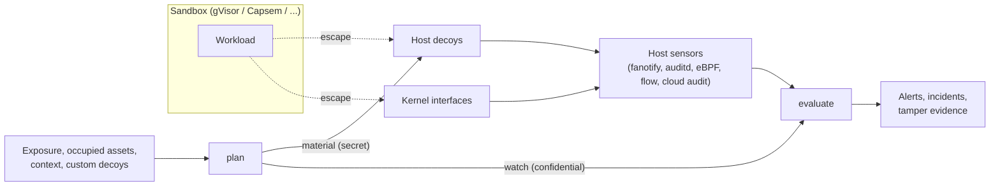

# Sandbox Escape Tripwire

This Component adds a defense-in-depth layer *outside* an existing workload sandbox
such as gVisor, Capsem, Firecracker, Cloud Hypervisor, or Kata. It does not replace
the sandbox and does not watch what happens inside it. Instead it plans **host
decoys**: plausible host assets (credential files, control sockets, host service
endpoints) that no legitimate sandboxed workload can reach, plus **tripwires** on the
kernel interfaces that escape techniques write to. Any contact means a host
compromise, and usually a sandbox escape. The tripwire then evaluates host-side sensor
events against the plan and reports breakouts.

The tripwire's value depends on these properties:

1. A decoy is never placed where a sandbox can legitimately reach it, through a host
   path, a path alias, or allowed egress, so ordinary workloads cannot trip it.
2. A decoy never displaces a real host asset, real service, or runtime-managed state.
3. Decoy credentials are real in format, and the ones that need it are real
   credentials, so their use is actually logged. Operators can add, move, and rotate
   decoys, so placement is not fully predictable from this specification.
4. Every decoy contact that is not trusted maintenance or self-testing is critical,
   and with probes configured, a decoy whose monitoring stops working end to end is
   reported.
5. The attacker cannot tell that they touched a decoy: decoys behave like real
   assets, observation is passive, and nothing on the host reacts to the contact.
6. Escapes that never touch bait are still seen: writes to kernel interfaces that
   hijack host-root helpers are tripwires, and processes those helpers launch are
   attributed as escapes.
7. Escapes that need no exploit are still seen: code an agent harness runs outside
   its sandbox is attributed to that harness.
8. Telemetry is authenticated per sensor, so a forged or altered event is rejected
   rather than trusted.

Version 0.1.0 is a pure, deterministic decision engine. It MUST NOT read or write the
filesystem, open network listeners, read the clock, or contact any network. Its only
ambient input is the optional seed environment variable defined below. Materializing
decoys and running sensors are the operator's responsibility (or a later
Component's); they consume the `plan` result and feed observed events into
`evaluate`.

## Threat model

The tripwire detects a workload that escapes its sandbox to the host, as any user, and
touches host assets or hijacks a kernel helper; an agent harness persuaded to run code
outside its sandbox; a sandbox reaching for host SSH; and the use of decoy credentials
wherever a monitored log records it. Attackers are
assumed to be capable AI agents that know published escape techniques and actively
look for decoys. It assumes:

- The sandbox remains the primary boundary; the tripwire neither prevents escapes nor
  observes activity inside a sandbox.
- Sensors, the prober, and event shipping run on the host outside every sandbox.
- Each decoy contact is shipped off the host as soon as it is observed. An attacker who
  gains host root or kernel write access can stop sensors or forge events afterwards,
  so only events recorded before that point are trustworthy; probes, sequence numbers,
  and corroboration by independent sensors make later tampering visible, not
  impossible.
- Suppressed executables and the probe executable are trusted host binaries that
  touch decoys without revealing their content; running them is equivalent to
  holding a suppression.

It never runs code on the attacker's side, even to attribute them: identification is
passive and uses only what host sensors recorded. Event authentication protects the
pipeline from unprivileged forgers and a compromised collector, not from an attacker
who has stolen a sensor key, and probes do not prove that the external logs recording
`credential-use` (cloud audit trails, SSH logs, token webhooks) are healthy.

## Application contract

`run` accepts exactly one positional argument: a JSON object with an `operation` field
whose value is `plan` or `evaluate`. The public callable preserves that one-object
boundary in every language; in Python it is `main(request)`. The process entrypoint
receives the complete JSON argument array in one command-line token, so its value is
`[request]`. The result is one JSON object written to standard output.

The decoy catalog, locations, credential material, and `plan` are specified in
`decoys/spec.md`; `evaluate` is specified in `evaluation/spec.md`, with event
authentication and tamper evidence in `telemetry/spec.md`; the requirements that keep
detection invisible to the attacker are in `stealth/spec.md`.

Every object in a request is strict: unknown fields, missing required fields, and
values of the wrong type are invalid. Identifier strings (`deployment_id`,
`sandbox_id`, `event_id`, `source`) MUST be nonempty. A timestamp is
`YYYY-MM-DDTHH:MM:SS`, optionally `.` and 1 to 9 digits, then `Z`, with seconds from
00 to 59; timestamps are compared by the instant they denote.

### Secrets

Command-line arguments are visible to every user on a host, so the request carries no
secret except as a test convenience:

- The **seed** keys every derived decoy credential. `plan` reads it from the
  environment variable `SANDBOX_HONEYPOT_SEED` when the request has no `seed` field.
  Exactly one of the two MUST be present, and the seed MUST be at least 32 bytes of
  UTF-8 so one exposed decoy cannot be used to brute-force it; anything else is
  invalid at `/seed`. Operators SHOULD use at least 32 random bytes. A request `seed`
  adds the warning `seed-in-request` to the result.
- The `plan` result separates `material` (derived credential secrets, to be handled
  like the seed and used only to materialize decoys) from `watch` (no credential
  secrets, but confidential because it names the decoys; see `stealth/spec.md`).
  `evaluate` takes only `watch`, which identifies credentials by SHA-256 digest.
  Provided credentials enter `plan` only as digests.
- Sensor keys reach `evaluate` through `SANDBOX_HONEYPOT_SENSOR_KEYS`, with the same
  test-only request fallback (`telemetry/spec.md`).

### Failures

An invalid request writes exactly `{"error": {"code": "invalid-request", "field":
POINTER}}` to standard output, where `POINTER` is an RFC 6901 JSON Pointer to the first
offending value (`""` for the whole request), and exits with status 2. A valid request,
including an `evaluate` request with rejected events, exits with status 0.

In the scenarios below, `SEED` is `tripwire-test-seed-0123456789abcdef`, and `P` is
the SHA-256 digest of `test-access-key-id`,
`ba2ec3831ba77da700ae57847f4ab9f6f3cce8658ea18257e814a7aca5e00f6a`. Decoy credentials
appear only as identifiers derived from `SEED`; realistic literal keys would be flagged
by secret scanners as leaks. Unstated list fields are empty; unstated `probe`,
`corroboration`, `sandbox_gateway`, `sequence`, `target_inode`, `mac`, and
`environment_names` are null; unstated `authentication` is `off`,
`max_clock_skew_seconds` is 300, and `received` equals the event's `time`; unstated
`window` is `2026-10-30T00:00:00Z` to `2026-10-31T00:00:00Z`; and unstated `context`
is organization `acme`, service user `deploy`, AWS region `us-east-1`, and, on
Kubernetes nodes, cluster `prod-east` with API server `10.0.0.1:6443` (otherwise
null). Planning scenarios are in `decoys/spec.md` and evaluation scenarios in
`evaluation/spec.md`.

### Requirement: Detection is invisible to the attacker

The tripwire SHALL treat every interaction with a decoy as a hit, so an attacker cannot
safely inspect a decoy, and decoy contact SHALL change nothing the attacker can observe
(`stealth/spec.md`).

#### Scenario: Metadata reconnaissance

- **GIVEN** the `watch` from the gVisor cloud-VM plan in `decoys/spec.md`
- **WHEN** event `s1` performs `stat` on `/home/deploy/.aws/credentials` with an all-null actor
- **THEN** the alert `s1/cloud-credentials` is `critical` with verdict `host-breach`

### Requirement: Fail closed on malformed requests

The tripwire SHALL reject malformed requests instead of guessing, because a silently
accepted bad exposure list or alias set could place decoys inside the sandbox
boundary.

#### Scenario: Guest-relative or host-name exposure

- **WHEN** `plan` receives exposure paths `["workspace"]`, or exposure endpoints `["metadata.internal:80"]`
- **THEN** it rejects the request at `/exposure/paths/0` or `/exposure/endpoints/0` respectively, writing the `invalid-request` error and exiting with status 2

#### Scenario: Chained aliases

- **WHEN** `plan` receives path aliases `/srv/run` → `/var/run/app`
- **THEN** it rejects the request at `/path_aliases/0/target`, because that target lies beneath the built-in alias `/var/run`

#### Scenario: Weak or duplicated seed

- **WHEN** `plan` receives request seed `test-seed`, or receives a valid request seed while `SANDBOX_HONEYPOT_SEED` is also set
- **THEN** it rejects the request at `/seed`

#### Scenario: Suppression for an unknown decoy

- **WHEN** `evaluate` receives a suppression whose `decoy_id` is not in `watch.decoys`
- **THEN** it rejects the request at `/suppressions/0/decoy_id`

#### Scenario: Relocated tripwire or missing cluster context

- **WHEN** `plan` receives a relocation for `core-pattern`, or runs for host profile `kubernetes-node` with a null `context.cluster_name`
- **THEN** it rejects the request at `/relocate/0/decoy_id` or `/context/cluster_name` respectively

#### Scenario: Revealing cover text or missing sensor keys

- **WHEN** `plan` receives a cover file whose content mentions a `honeypot`, or `evaluate` requires authentication with neither request nor environment sensor keys
- **THEN** it rejects the request at `/cover_files/0/content` or `/sensor_keys` respectively
