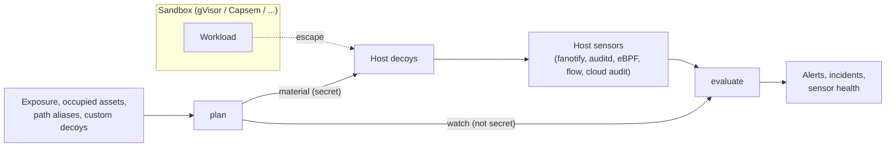

# Sandbox Escape Tripwire

This Component adds a defense-in-depth layer *outside* an existing workload sandbox
such as gVisor, Capsem, Firecracker, or Kata. It does not replace the sandbox and does
not watch what happens inside it. Instead it plans **host decoys**: plausible host
assets (credential files, control sockets, a metadata endpoint) that no legitimate
sandboxed workload can reach. Because the sandbox boundary makes them unreachable, any
contact with a decoy means a host compromise, and usually a sandbox escape. The
tripwire then evaluates host-side sensor events against the planned decoys and reports
breakouts.

The tripwire's value depends on these properties:

1. A decoy is never placed where a sandbox can legitimately reach it, including
   through a path alias, so ordinary workloads cannot trip it.
2. A decoy never displaces a real host asset or real service.
3. Decoy credentials are indistinguishable in format from real ones, and operators
   can add decoys of their own so the placement is not fully predictable from this
   specification.
4. Every decoy contact that is not an explicitly suppressed maintenance access is
   critical, and a sensor cannot be silenced or blinded without the tripwire saying so.

Version 0.1.0 is a pure, deterministic decision engine. It MUST NOT read or write the
filesystem, open network listeners, read the clock, or contact any network. Its only
ambient input is the optional seed environment variable defined below. Materializing
decoys and running sensors are the operator's responsibility (or a later
Component's); they consume the `plan` result and feed observed events into
`evaluate`.

## Application contract

`run` accepts exactly one positional argument: a JSON object with an `operation` field
whose value is `plan` or `evaluate`. The public callable preserves that one-object
boundary in every language; in Python it is `main(request)`. The process entrypoint
receives the complete JSON argument array in one command-line token, so its value is
`[request]`. The result is one JSON object written to standard output.

The decoy catalog, path aliases, credential material, and `plan` are specified in
`decoys/spec.md`; `evaluate` is specified in `evaluation/spec.md`.

Every object in a request is strict: unknown fields, missing required fields, and
values of the wrong type are invalid. Identifier strings (`deployment_id`,
`sandbox_id`, `event_id`, `source`) MUST be nonempty. An RFC 3339 timestamp is a UTC
time with the `Z` suffix and optional fractional seconds; timestamps are compared by
the instant they denote.

### Secrets

Command-line arguments are visible to every user on a host, so the request carries no
secret except as a test convenience:

- The **seed** keys every decoy credential. `plan` reads it from the environment
  variable `SANDBOX_HONEYPOT_SEED` when the request has no `seed` field. Exactly one of
  the two MUST be present and nonempty; both or neither is invalid (field `/seed`). A
  request `seed` is accepted for tests and adds the warning `seed-in-request` to the
  result.
- The `plan` result separates `material` (decoy credential secrets, to be handled
  like the seed and used only to materialize decoys) from `watch` (no secrets).
  `evaluate` takes only `watch`, which identifies decoy credentials by SHA-256 digest.

### Failures

An invalid request writes exactly `{"error": {"code": "invalid-request", "field":
POINTER}}` to standard output, where `POINTER` is an RFC 6901 JSON Pointer to the first
offending value (`""` for the whole request), and exits with status 2. A valid request,
including an `evaluate` request with rejected events, exits with status 0.

### Requirement: Host decoys stay outside the sandbox boundary

The tripwire SHALL never plan a decoy that a sandbox can legitimately reach, directly
or through a path alias, and SHALL never plan a decoy over a real host asset or
service.

#### Scenario: gVisor on a cloud VM

- **WHEN** `plan` runs with request seed `test-seed` for deployment `prod-agents`, runtime `gvisor`, host profile `linux-host`, environment `cloud-vm`, exposure paths `["/root/.ssh"]`, no exposure endpoints, occupied `["/run/docker.sock"]`, and no aliases, custom decoys, or exclusions
- **THEN** `warnings` is `["seed-in-request"]` and `watch.decoys` holds `cloud-credentials` (canary digest `af6f7c5cd8e184365df3568295a722fcba5df8381da9b1da78a11ff5d6c7f144`) and `runtime-control` at `/run/runsc/control.sock`
- **AND** `material` holds only `cloud-credentials`, whose access key ID is `AKIA` plus 16 base32 characters with SHA-256 equal to that canary digest, and whose 40-character secret access key has SHA-256 `f7890ca8bf35c5ff10b6a05987ebc1fa0ab7851afb4dc7652f8d758b7fc48358`
- **AND** this specification states decoy credentials only by digest, because their realistic format makes secret scanners treat literal values as leaked keys
- **AND** `skipped` lists `ssh-private-key` as `exposed`, `container-socket` (location `/var/run/docker.sock`) as `occupied` through the built-in alias, and `metadata-endpoint` as `real-service`, in catalog order

#### Scenario: Sandbox that mounts the aliased run directory

- **WHEN** `plan` runs for runtime `capsem` with exposure paths `["/var/run"]`
- **THEN** `container-socket` and `runtime-control` (location `/run/capsem/control.sock`) are both skipped as `exposed`, because both canonical locations lie beneath `/run`

#### Scenario: Kubernetes node with a custom decoy

- **WHEN** `plan` runs with request seed `test-seed` for deployment `k8s-node-1`, runtime `kata`, host profile `kubernetes-node`, environment `bare-metal`, empty exposure and occupied lists, exclusion `["container-socket"]`, and custom decoy `ops-kubeconfig` of kind `credential-file` at `/home/ops/.kube/config` with technique `T1552.001` and format `kubeconfig-token`
- **THEN** `watch.decoys` lists `cloud-credentials`, `ssh-private-key`, `metadata-endpoint`, `runtime-control` (at `/run/kata-containers/shim.sock`), `kubeconfig`, and `ops-kubeconfig`, in that order, and `container-socket` is skipped as `excluded`
- **AND** the `ssh-private-key` fingerprint is `SHA256:IvnjpAo829DjMb8GQuqMcahF8yb5OpOJ8KD5UynBOjs`, the `kubeconfig` token is `lkctwr.x3y1n7oqjfomlqps`, and the `ops-kubeconfig` token is `hh7xi1.47vcz0lsv1534xw6`

### Requirement: Decoy contact is a critical breakout

The tripwire SHALL turn every unsuppressed decoy contact into a critical, attributed
alert, and SHALL NOT let a self-reported process name suppress or change one.

#### Scenario: Escape, impostor maintenance tool, and exfiltration

- **GIVEN** the `watch` from the gVisor cloud-VM plan, sandbox `sbx-1` with host PIDs `[4100]`, and a suppression for `cloud-credentials`, executable `/usr/bin/restic`, uid 0
- **WHEN** `evaluate` receives event `e1` at `2026-10-30T12:00:00Z` where PID 4242 with ancestry `[4100, 1]` running `/usr/bin/python3` performs `connect` on `/run/runsc/control.sock`; `e2` at `12:01:00Z` where `/usr/bin/restic` as uid 0 reads `/root/.aws/credentials`; `e3` at `12:02:00Z` where a process named `restic` running `/tmp/.x/restic` as uid 0 with ancestry `[1]` reads `/root/.aws/credentials`; and `e4` at `12:05:00Z` from source `cloudtrail` with `credential-use` on a target equal to that plan's `cloud-credentials` access key ID and an all-null actor with empty ancestry
- **THEN** the alerts are `e1/runtime-control` (`escape-confirmed`, attribution `ancestry`, sandbox `sbx-1`, techniques `["T1611"]`), `e3/cloud-credentials` (`host-breach`, sandbox null, process `restic`, techniques `["T1611", "T1552.001"]`), and `e4/cloud-credentials` (`credential-exfiltrated`, techniques `["T1552.001", "T1078"]`), all `critical`
- **AND** `suppressed` lists only `e2`, and the incidents are `sbx-1` with `["e1/runtime-control"]`, then the unattributed incident with `["e3/cloud-credentials", "e4/cloud-credentials"]`

#### Scenario: Alias path and simultaneous alerts

- **GIVEN** the same `watch` and sandbox
- **WHEN** event `a2` reads `/root/.aws/credentials` with an all-null actor and event `a1`, reported by a runtime-aware sensor with `actor.sandbox_id` `sbx-1` and empty ancestry, connects to `/var/run/runsc/control.sock`, both at `2026-10-30T12:00:00Z`
- **THEN** `a1/runtime-control` (attribution `sensor`) precedes `a2/cloud-credentials`, and the `sbx-1` incident precedes the unattributed incident

### Requirement: Malformed or missing telemetry is visible

The tripwire SHALL keep evaluating valid events when others are malformed, and SHALL
report sensors that fall silent.

#### Scenario: One malformed event

- **WHEN** `evaluate` receives a first event whose `time` is `2026-10-30 12:00` and a second, valid event that connects to `/run/runsc/control.sock`
- **THEN** the second event still produces an alert, `rejected` is `[{"index": 0, "field": "/time"}]`, and `degraded` and `breached` are both true

#### Scenario: Silent sensor

- **WHEN** the window is `2026-10-30T12:00:00Z` to `2026-10-30T13:00:00Z`, sensor `fanotify` allows 600 seconds of silence, and the only events are `fanotify` heartbeats at `12:00:00Z`, `12:10:00Z`, and `12:30:00Z`
- **THEN** `sensor_gaps` holds `fanotify` from `12:10:00Z` to `12:30:00Z` and from `12:30:00Z` to `13:00:00Z`, `degraded` is true, `breached` is false, and `ignored` is 0

### Requirement: Fail closed on malformed requests

The tripwire SHALL reject malformed requests instead of guessing, because a silently
accepted bad exposure list or alias set could place decoys inside the sandbox
boundary.

#### Scenario: Relative exposure path

- **WHEN** `plan` receives exposure paths `["root/.ssh"]`
- **THEN** it writes the `invalid-request` error with field `/exposure/paths/0` and exits with status 2

#### Scenario: Chained aliases

- **WHEN** `plan` receives path aliases `/srv/run` → `/var/run/app`
- **THEN** it rejects the request at `/path_aliases/0/target`, because that target lies beneath the built-in alias `/var/run`

#### Scenario: Seed supplied twice

- **WHEN** `plan` receives a request `seed` while `SANDBOX_HONEYPOT_SEED` is also set
- **THEN** it rejects the request at `/seed`
