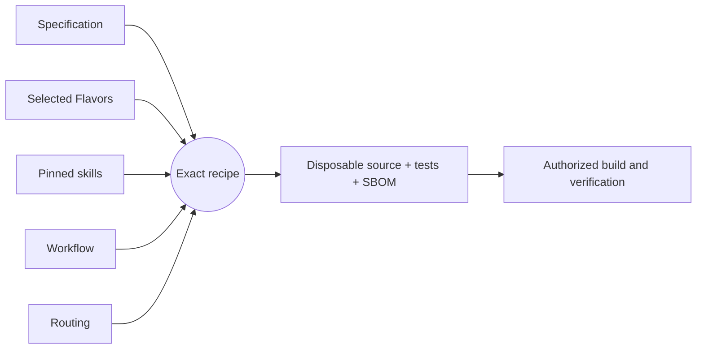

# Getting started

[Project guide](../README.md) → getting started

## What is this project?

A workload sandbox (gVisor, Capsem, Firecracker, Kata) is the isolation boundary for
untrusted code and AI agents. sandbox-honeypot assumes that boundary can fail and adds
an independent alarm behind it. It plans **host decoys**: plausible host assets such as
`/root/.aws/credentials`, a container or runtime control socket, and a cloud metadata
endpoint. Each decoy is placed only where no sandbox can legitimately reach it, so any
contact means a workload escaped. Host sensor events that touch a decoy, or a canary
credential being used anywhere, become attributed alerts and incidents.

The behavior is specified in
`components/sandbox-tripwire/component.md`.

## Installation

**Not packaged yet.** Version 0.1.0 is a specification; the generated Python
application, its pip package, and an install path are tracked by
[TRIP-001](../roadmap/active-work.md). Until then, contributors build it with the
development workflow below.

## Usage

The application exposes one `run` entrypoint that takes a single JSON object.

1. **Provision an AWS canary.** Create an IAM user whose policy denies everything,
   in an account whose audit trail (including denied calls) you collect. A made-up
   key would never be logged when used. Pass only the SHA-256 of its access key ID.

2. **Plan decoys** on a system outside the protected host. Put at least 32 random bytes in `SANDBOX_HONEYPOT_SEED` (never on
   the command line), then describe the deployment. `exposure` lists **host-side**
   paths any sandbox can reach (mount and share sources, not guest paths) and the
   addresses its egress allows (`*:*` for unrestricted). `occupied` lists real host
   assets, including runtime state directories:

   ```json
   {"operation": "plan", "deployment_id": "prod-agents", "runtime": "gvisor",
    "host_profile": "linux-host", "host_environment": "cloud-vm",
    "exposure": {"paths": ["/srv/agents"], "endpoints": ["*:443"]},
    "occupied": ["/run/docker.sock", "/var/run/runsc"], "path_aliases": [],
    "exclude": [], "relocate": [], "custom_decoys": [], "epochs": [],
    "provided_credentials": [{"decoy_id": "cloud-credentials",
                              "identifier_digest": "<sha256 of key ID>"}]}
   ```

   The result has three parts: `material` holds derived secrets (OpenSSH key,
   Kubernetes token), `watch` describes what to monitor (no secrets, but keep it off the
   protected host because it names the decoys), and
   `skipped` explains each decoy left out. To rotate one decoy, raise its epoch.

3. **Place the decoys and watch them.** Write each credential decoy (the AWS one from
   your IAM user, the rest from `material`), create the socket and endpoint decoys,
   record their device and inode numbers, then delete `material`. Point host-side
   sensors (fanotify, auditd, eBPF, flow logs, cloud audit logs) at the `watch`
   locations using notification-only mechanisms (never blocking or denying access),
   and ship each event off the host immediately. Nothing on the host may react
   visibly: the attacker must not learn they touched a decoy. Enable `LogLevel
   VERBOSE` on SSH servers and a token webhook for Kubernetes so credential use is
   logged. Run a self-test prober that touches every decoy on a jittered schedule
   without changing file timestamps. Version
   0.1.0 does not do this for you.

4. **Evaluate events** off the host. Send `watch`, each sandbox's runtime process identities (PID
   and start ticks), maintenance suppressions (by executable and uid), the prober,
   an observation window, decoy inodes, and sensor events as
   `{"operation": "evaluate", ...}`. The result reports `breached` with critical
   alerts that separate escaped processes from runtime-mediated contact, and
   `degraded` when events were malformed or duplicated or a decoy's monitoring broke.

---

## Development workflow

This project uses [Literate AI](https://github.com/jordanhubbard/literate-ai) to
keep specifications as durable authority and generate source, current tests, and a
CycloneDX source SBOM into a disposable workspace. The commands below are for
contributors, not end users.

Validate the project and inspect the exact recipe (planning does not invoke a
model or execute generated code):

```console
litai project validate
litai lock --check
litai plan components/sandbox-tripwire
```

Every non-empty initialized project begins with a portable hello Component. With an
authenticated coding CLI and the selected host toolchain, prove the complete local
lifecycle before changing it:

```console
litai rebuild samples/hello-component --project . \
  --allow-host-execution --update-receipt
```

The rebuild generates source and current tests from the specification, builds a
runnable artifact, runs both generated and independent acceptance tests, executes the
application, and commits the compact current passing receipt. Modify
`samples/hello-component/component.md` to begin the first application, or use
`litai init --empty` when no starter is wanted.

Invoke the `Execute:` command printed by rebuild with `{"name":"LitAI"}` as its one
argument. The known output is exactly
`{"greeting":"Hello, LitAI!","name":"LitAI"}`.



`+flavor` selects a variation and `-flavor` removes one. Explicit Component and
Flavor requirements outrank defaults, so `-bazel` removes the scaffold's Bazel
preference before prompt assembly. Read the [framework flow](framework-flow.md) before
adding a lifecycle driver that compiles or runs generated source, and use the
[project map](project-layout.md) to change the owning artifact.
