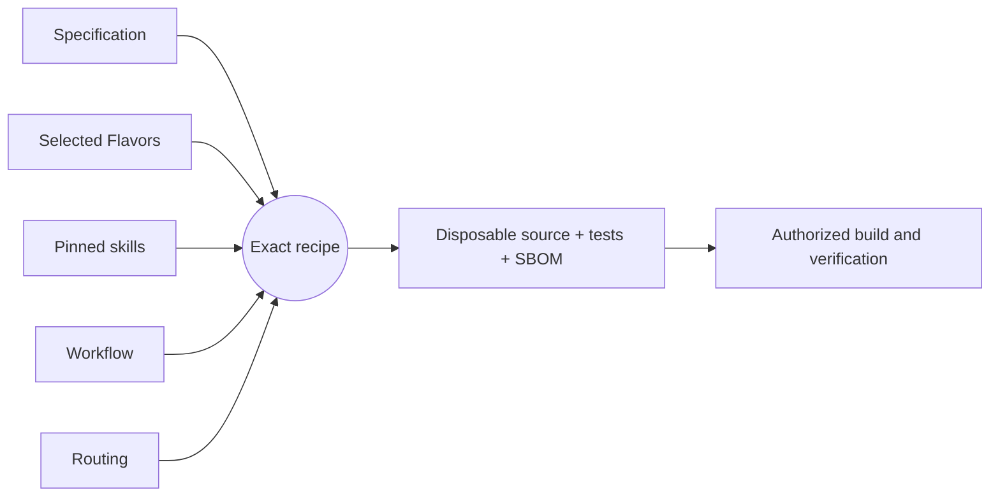

# Getting started

[Project guide](../README.md) → getting started

## What is this project?

A workload sandbox (gVisor, Capsem, Firecracker, Kata) is the isolation boundary for
untrusted code and AI agents. sandbox-honeypot assumes that boundary can fail and adds
an independent alarm behind it. It plans **host decoys**: plausible host assets such as
`/root/.aws/credentials`, a container or runtime control socket, and a cloud metadata
endpoint. Each decoy is placed only where no sandbox can legitimately reach it, so any
contact means a workload escaped. Host sensor events that touch a decoy, or a canary
credential being used anywhere, become attributed alerts and incidents.

The behavior is specified in
`components/sandbox-tripwire/component.md`.

## Installation

**Not packaged yet.** Version 0.1.0 is a specification; the generated Python
application, its pip package, and an install path are tracked by
[TRIP-001](../roadmap/active-work.md). Until then, contributors build it with the
development workflow below.

## Usage

The application exposes one `run` entrypoint that takes a single JSON object.

1. **Plan decoys.** Describe the deployment, its sandbox runtime, everything the
   sandbox can legitimately reach (`exposure`), and real host assets (`occupied`):

   ```json
   {"operation": "plan", "deployment_id": "prod-agents", "runtime": "gvisor",
    "host_profile": "linux-host", "seed": "<secret>",
    "exposure": {"paths": ["/root/.ssh"], "endpoints": ["169.254.169.254:*"]},
    "occupied": ["/var/run/docker.sock"]}
   ```

   The result lists the decoys to place (each with a canary token to embed) and the
   catalog decoys skipped as `exposed` or `occupied`.

2. **Place the decoys and watch them.** Materialize each decoy at its location with
   its canary, and point host-side sensors (fanotify, auditd, eBPF, flow logs, cloud
   audit logs) at those locations and canaries. Version 0.1.0 does not do this for you.

3. **Evaluate events.** Send the plan, the deployment's sandbox IDs, sensor events,
   and any maintenance suppressions as `{"operation": "evaluate", ...}`. The result
   reports `breached`, ordered alerts with ATT&CK techniques, and per-sandbox
   incidents.

---

## Development workflow

This project uses [Literate AI](https://github.com/jordanhubbard/literate-ai) to
keep specifications as durable authority and generate source, current tests, and a
CycloneDX source SBOM into a disposable workspace. The commands below are for
contributors, not end users.

Validate the project and inspect the exact recipe (planning does not invoke a
model or execute generated code):

```console
litai project validate
litai lock --check
litai plan components/sandbox-tripwire
```

Every non-empty initialized project begins with a portable hello Component. With an
authenticated coding CLI and the selected host toolchain, prove the complete local
lifecycle before changing it:

```console
litai rebuild samples/hello-component --project . \
  --allow-host-execution --update-receipt
```

The rebuild generates source and current tests from the specification, builds a
runnable artifact, runs both generated and independent acceptance tests, executes the
application, and commits the compact current passing receipt. Modify
`samples/hello-component/component.md` to begin the first application, or use
`litai init --empty` when no starter is wanted.

Invoke the `Execute:` command printed by rebuild with `{"name":"LitAI"}` as its one
argument. The known output is exactly
`{"greeting":"Hello, LitAI!","name":"LitAI"}`.



`+flavor` selects a variation and `-flavor` removes one. Explicit Component and
Flavor requirements outrank defaults, so `-bazel` removes the scaffold's Bazel
preference before prompt assembly. Read the [framework flow](framework-flow.md) before
adding a lifecycle driver that compiles or runs generated source, and use the
[project map](project-layout.md) to change the owning artifact.
