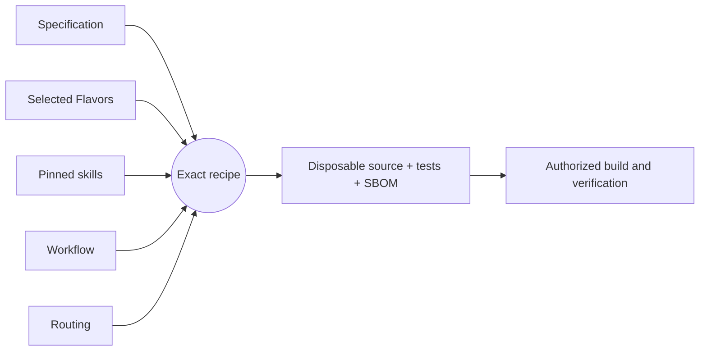

# Getting started

[Project guide](../README.md) → getting started

## What is this project?

A workload sandbox (gVisor, Capsem, Firecracker, Kata) is the isolation boundary for
untrusted code and AI agents. sandbox-honeypot assumes that boundary can fail and adds
an independent alarm behind it. It plans **host decoys**: plausible host assets such as
`/root/.aws/credentials`, a container or runtime control socket, and a cloud metadata
endpoint. Each decoy is placed only where no sandbox can legitimately reach it, so any
contact means a workload escaped. Host sensor events that touch a decoy, or a canary
credential being used anywhere, become attributed alerts and incidents.

The behavior is specified in
`components/sandbox-tripwire/component.md`.

## Installation

**Not packaged yet.** Version 0.1.0 is a specification; the generated Python
application, its pip package, and an install path are tracked by
[TRIP-001](../roadmap/active-work.md). Until then, contributors build it with the
development workflow below.

## Usage

The application exposes one `run` entrypoint that takes a single JSON object.

1. **Plan decoys.** Put the secret seed in `SANDBOX_HONEYPOT_SEED` (never on the
   command line), then describe the deployment, everything the sandbox can
   legitimately reach (`exposure`), real host assets (`occupied`), any symlinked
   directories (`path_aliases`), and optional decoys of your own:

   ```json
   {"operation": "plan", "deployment_id": "prod-agents", "runtime": "gvisor",
    "host_profile": "linux-host", "host_environment": "cloud-vm",
    "exposure": {"paths": ["/root/.ssh"], "endpoints": []},
    "occupied": ["/run/docker.sock"], "path_aliases": [],
    "custom_decoys": [], "exclude": []}
   ```

   The result has three parts: `material` holds the secret decoy credentials, in
   realistic AWS, OpenSSH and Kubernetes token formats. `watch` describes what to
   monitor and contains no secrets. `skipped` explains each decoy left out.

2. **Place the decoys and watch them.** Write each credential decoy from `material`,
   create the socket and endpoint decoys, then delete `material`. Point host-side
   sensors (fanotify, auditd, eBPF, flow logs, cloud audit logs) at the `watch`
   locations, and send periodic heartbeats. Version 0.1.0 does not do this for you.

3. **Evaluate events.** Send `watch`, the sandboxes' host PIDs, an observation window,
   the expected sensors, maintenance suppressions (by executable and uid), and sensor
   events as `{"operation": "evaluate", ...}`. The result reports `breached` with
   critical, attributed alerts and per-sandbox incidents, and `degraded` when events
   were malformed or a sensor went silent.

---

## Development workflow

This project uses [Literate AI](https://github.com/jordanhubbard/literate-ai) to
keep specifications as durable authority and generate source, current tests, and a
CycloneDX source SBOM into a disposable workspace. The commands below are for
contributors, not end users.

Validate the project and inspect the exact recipe (planning does not invoke a
model or execute generated code):

```console
litai project validate
litai lock --check
litai plan components/sandbox-tripwire
```

Every non-empty initialized project begins with a portable hello Component. With an
authenticated coding CLI and the selected host toolchain, prove the complete local
lifecycle before changing it:

```console
litai rebuild samples/hello-component --project . \
  --allow-host-execution --update-receipt
```

The rebuild generates source and current tests from the specification, builds a
runnable artifact, runs both generated and independent acceptance tests, executes the
application, and commits the compact current passing receipt. Modify
`samples/hello-component/component.md` to begin the first application, or use
`litai init --empty` when no starter is wanted.

Invoke the `Execute:` command printed by rebuild with `{"name":"LitAI"}` as its one
argument. The known output is exactly
`{"greeting":"Hello, LitAI!","name":"LitAI"}`.



`+flavor` selects a variation and `-flavor` removes one. Explicit Component and
Flavor requirements outrank defaults, so `-bazel` removes the scaffold's Bazel
preference before prompt assembly. Read the [framework flow](framework-flow.md) before
adding a lifecycle driver that compiles or runs generated source, and use the
[project map](project-layout.md) to change the owning artifact.
